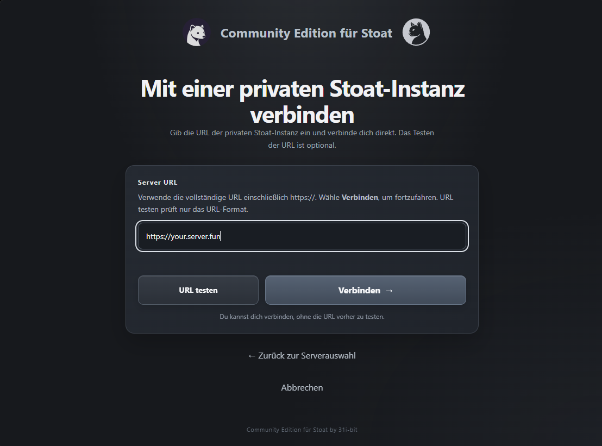

# 🐈‍⬛ Stoat Community Edition by 31i-bit

**One client. Your server.**

## ⬇️ WINDOWS DOWNLOAD / WINDOWS HERUNTERLADEN

### [⬇️ WINDOWS-INSTALLER HERUNTERLADEN – VERSION 1.0.0 (.EXE)](https://github.com/31i-bit/stoat-windows-client/releases/download/community-v1.0.0/community-setup-win-x64.exe)

**Windows 10/11 · 64 Bit (x64)**

**Deutsch:** Herunterladen, installieren, Serveradresse einmal eingeben und loslegen. Kein GitHub-Konto erforderlich.

**English:** Download, install, enter your server address once, and get started. No GitHub account required.

[Weitere Downloads: Portable ZIP, Quellcode und Prüfsumme / Other downloads: Portable ZIP, source code and checksum](https://github.com/31i-bit/stoat-windows-client/releases/tag/community-v1.0.0)

---

## Deutsch 🇩🇪

Ein komfortabler Windows-Desktop-Client für **Stoat Retail und selbst gehostete Stoat-Server**.

**Die zusätzlichen Funktionen stehen allen Nutzern zur Verfügung!**

- Serverwechsel direkt im Client – keine BAT-Dateien und kein `--force-server` nötig
- Globale, konfigurierbare Hotkeys
- Optionales Push-to-Talk (PTT), auch für Spiele
- Optionaler Eingabe-Helper für Spiele mit eingeschränkter Tastaturerfassung
- Benutzerfreundlicher Windows-Installer
- Integrierte Updatefunktion

**Unser Ziel:** Stoat nicht ersetzen, sondern die Desktop-Nutzung komfortabler machen.

Ein Hinweis zur Windows-Sicherheit:
Die Anwendung durchläuft derzeit die Sicherheitsüberprüfung durch Microsoft. Bis dieser Prozess abgeschlossen ist, können Windows Defender oder andere Sicherheitssoftware Warnmeldungen anzeigen – insbesondere im Hinblick auf den optionalen PTT-Helfer, der bei expliziter Aktivierung mit erweiterten Berechtigungen arbeitet.

Das Projekt ist ein Community-Projekt und keine offizielle Veröffentlichung von Stoat. Der Quellcode unserer Modifikationen ist noch nicht öffentlich zugänglich.

## English 🇬🇧

A more convenient Windows desktop client for **Stoat Retail and self-hosted Stoat servers**.

**All additional features work with both!**

- Switch servers directly in the client – no BAT files or `--force-server` workarounds
- Configurable global hotkeys
- Optional push-to-talk (PTT), including gaming support
- Optional input helper for games with restricted keyboard input
- User-friendly Windows installer
- Built-in updater

**Our goal:** Not to replace Stoat, but to make the desktop experience better.

A note about Windows security:
The application is currently undergoing Microsoft's security review. Until that process is complete, Windows Defender or other security software may display warnings, especially for the optional PTT helper, which uses elevated permissions when explicitly enabled.

The project is community-driven and not an official Stoat release. The source code of our modifications is not yet publicly available.

## Screenshots / Bildschirmfotos
---

### Server selection / Serverauswahl

**Choose your server / Server auswählen**

**Private server connection / Privaten Server verbinden**

### Desktop controls / Desktop-Steuerung

| Push-to-Talk / PTT | Global hotkeys / Globale Hotkeys |
|:--:|:--:|
|  |  |

### Windows installer / Windows-Installer

  
