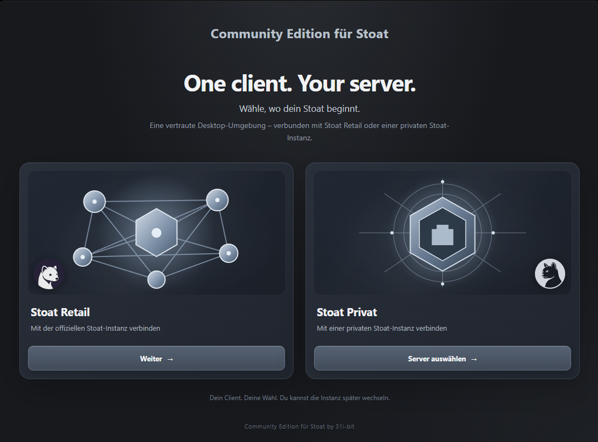
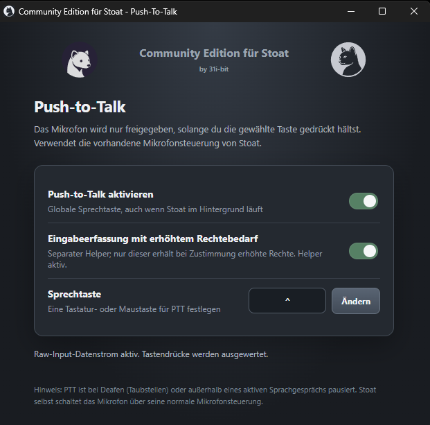
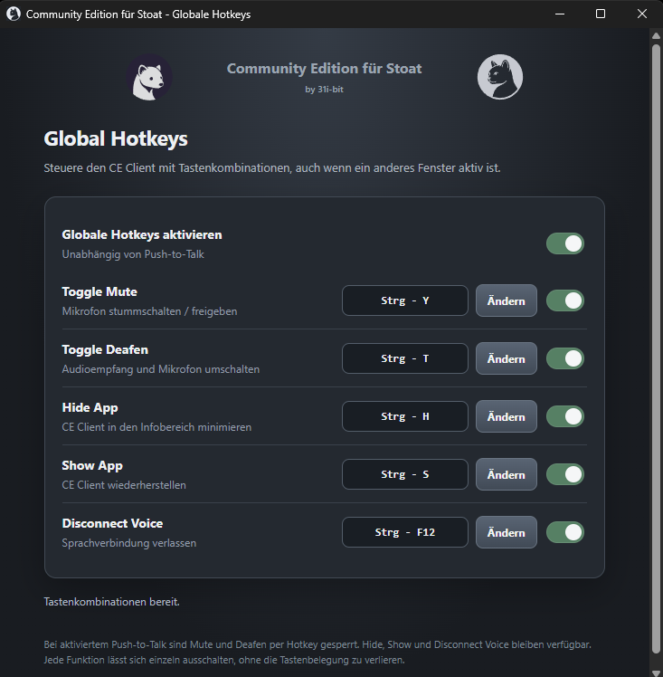
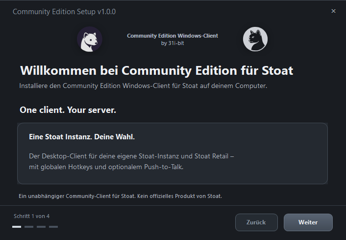

# 🐈‍⬛ Community Edition für Stoat
by 31i-bit

**One client. Your server.**

## ⬇️ WINDOWS DOWNLOAD / WINDOWS HERUNTERLADEN

### [⬇️ WINDOWS-INSTALLER HERUNTERLADEN – VERSION 1.0.0 (.EXE)](https://github.com/31i-bit/stoat-windows-client/releases/download/community-v1.0.0/community-setup-win-x64.exe)

**Windows 10/11 · 64 Bit (x64)**

**Deutsch:** Herunterladen, installieren, Serveradresse einmal eingeben und loslegen. Kein GitHub-Konto erforderlich.

**English:** Download, install, enter your server address once, and get started. No GitHub account required.

[Weitere Downloads: Portable ZIP, Quellcode und Prüfsumme / Other downloads: Portable ZIP, source code and checksum](https://github.com/31i-bit/stoat-windows-client/releases/tag/community-v1.0.0)

---

## Deutsch 🇩🇪

Die Community Edition für Stoat ist ein unabhängiger Open-Source-Desktop-Client für Windows, der sowohl offizielle als auch private Stoat-Instanzen unterstützt.

**Die zusätzlichen Funktionen stehen allen Nutzern zur Verfügung!**

- Serverwechsel direkt im Client – keine BAT-Dateien und kein `--force-server` nötig
- Globale, konfigurierbare Hotkeys
- Optionales Push-to-Talk (PTT), auch für Spiele
- Optionaler Eingabe-Helper für Spiele mit eingeschränkter Tastaturerfassung
- Benutzerfreundlicher Windows-Installer
- Integrierte Updatefunktion

**Unser Ziel:** Die bestehende Stoat-Plattform durch zusätzlichen Bedienkomfort und erweiterte Desktop-Funktionen ergänzen.

### Optionaler PTT-Helfer

Der CE Client bietet einen separaten, optionalen PTT-Helfer, um Tastatureingaben auch in Spielen mit besonderen Anforderungen an die Eingabeerfassung zuverlässig zu erkennen. Er wird nur bei ausdrücklicher Aktivierung gestartet und kann erhöhte Windows-Berechtigungen benötigen. Der CE Client ist auch ohne Helper vollständig nutzbar.

### Windows-Sicherheit

Microsoft hat nach der bisherigen Rückmeldung keine grundsätzlichen Einwände gegen die Verwendung eines solchen Hilfsprogramms geäußert. Eine einzelne Erkennung durch Windows Defender wurde Microsoft zur Überprüfung vorgelegt. Abhängig von den Sicherheitseinstellungen können weiterhin Warnmeldungen auftreten. Dies stellt keine allgemeine Sicherheitsfreigabe durch Microsoft dar.

### Über das Projekt

Die Community Edition für Stoat ist ein unabhängiges Community-Projekt von 31i-bit und kein offizielles Produkt von Stoat. Das Projekt basiert auf dem Open-Source-Desktop-Client von Stoat und wird unter der AGPLv3 veröffentlicht. Der Quellcode steht im jeweiligen Release zum Download bereit.

## English 🇬🇧

Community Edition for Stoat is an independent, open-source Windows desktop client supporting both official and self-hosted Stoat instances.

**All additional features work with both!**

- Switch servers directly in the client – no BAT files or `--force-server` workarounds
- Configurable global hotkeys
- Optional push-to-talk (PTT), including gaming support
- Optional input helper for games with restricted keyboard input
- User-friendly Windows installer
- Built-in updater

**Our goal:** To complement the existing Stoat platform with improved usability and additional desktop features.

### Optional PTT helper

The CE Client includes a separate, optional PTT helper designed to reliably capture keyboard input in games with special input capture requirements. It starts only when explicitly enabled and may require elevated Windows permissions. The CE Client remains fully usable without the helper.

### Windows security

Based on the feedback received so far, Microsoft has raised no fundamental objections to the use of such a helper. An individual Windows Defender detection has been submitted to Microsoft for review. Depending on security settings, warnings may still occur. This does not constitute a general security approval by Microsoft.

### About the project

Community Edition for Stoat is an independent community project by 31i-bit and is not an official Stoat product. It is based on the open-source Stoat desktop client and is released under the AGPLv3 license. Source code is available for download with the corresponding release.

## Screenshots / Bildschirmfotos
---

### Server selection / Serverauswahl

**Choose your server / Server auswählen**

**Private server connection / Privaten Server verbinden**

### Desktop controls / Desktop-Steuerung

| Push-to-Talk / PTT | Global hotkeys / Globale Hotkeys |
|:--:|:--:|
|  |  |

### Windows installer / Windows-Installer

  
